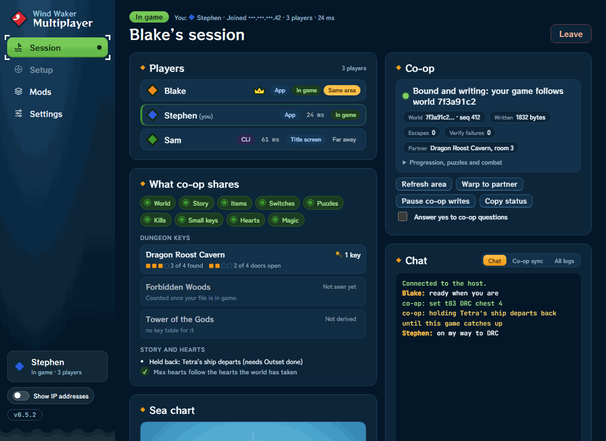

# Wind Waker Multiplayer

**Sail the Great Sea together.** Real-time visual multiplayer for *The Legend of Zelda: The Wind Waker* on Dolphin. Run the app next to your own Dolphin and you see your friends' Links walking, swinging and sailing through your game, in their own tunic colors, at their real positions with their real animations.

## Why you'll like it

- **One app does it all.** First-run Setup patches your own disc and finds Dolphin, a lobby gathers everyone, and the host's **Start** launches every player's Dolphin.
- **Joining is easy.** Sessions on your network show up with a Join button; anyone else pastes a short join code like `WW-30AG-09AX`.
- **Shared enemies.** The host's Moblins, Bokoblins and ChuChus are the real ones, and a hit from any player counts.
- **Optional co-op worlds.** Share story progress, items and switches across everyone's saves.
- **Safe to stream.** IP addresses are hidden on screen.
- **Windows and macOS** (Apple Silicon and Intel).
- **Built on a modding API.** Multiplayer and co-op are mods on `wwapi`; write your own.

## Get started in minutes

You need [Dolphin](https://dolphin-emu.org/) and your own copy of Wind Waker (NTSC-U, `GZLE01`). We never ship the game.

**Windows**
1. Download `ww-multiplayer.exe` from the [latest release](https://github.com/StephenSHorton/ww-multiplayer/releases) and double-click it. (If SmartScreen warns: **More info → Run anyway**.)
2. In **Setup**, pick your name and color, your Wind Waker disc and Dolphin.
3. **Host** a session or **Join** one, then press **Start**.

**macOS**
1. Download `ww-multiplayer-macos.zip` from the [latest release](https://github.com/StephenSHorton/ww-multiplayer/releases), unzip it and Control-click **WW Multiplayer.app → Open**.
2. In **Setup**, pick your name, disc and Dolphin, and press **Prepare Dolphin** once.
3. **Host** or **Join**, then press **Start**.

Step-by-step with all the details: [Getting started](docs/getting-started.md).

Friends on another network? A VPN is optional: [Tailscale](https://tailscale.com) and [Toru](https://stephenshorton.github.io/toru/) both work, or forward a port. See [Playing](docs/playing.md).

## Documentation

Everything else lives in [docs/](docs/README.md):

- [Getting started](docs/getting-started.md) · [Playing](docs/playing.md) · [Updates](docs/updates.md)
- [Self-hosting a dedicated server](docs/11-self-hosting.md)
- [Building from source](docs/building.md) · [Developer setup](docs/dev-setup.md) · [Releasing](docs/releasing.md)
- [Architecture](docs/01-architecture.md) · [Modding API](docs/api/00-design.md) · [Testing](docs/TESTING.md)
- [Open work on GitHub issues](https://github.com/StephenSHorton/ww-multiplayer/issues)

## License

[MIT](LICENSE) — do whatever you want with it, no warranty, not liable.

This project does not include or distribute any Nintendo IP. The patcher splices our own injected code into your own legitimately-acquired Wind Waker disc image. You are responsible for the legality of your own ISO in your jurisdiction.
