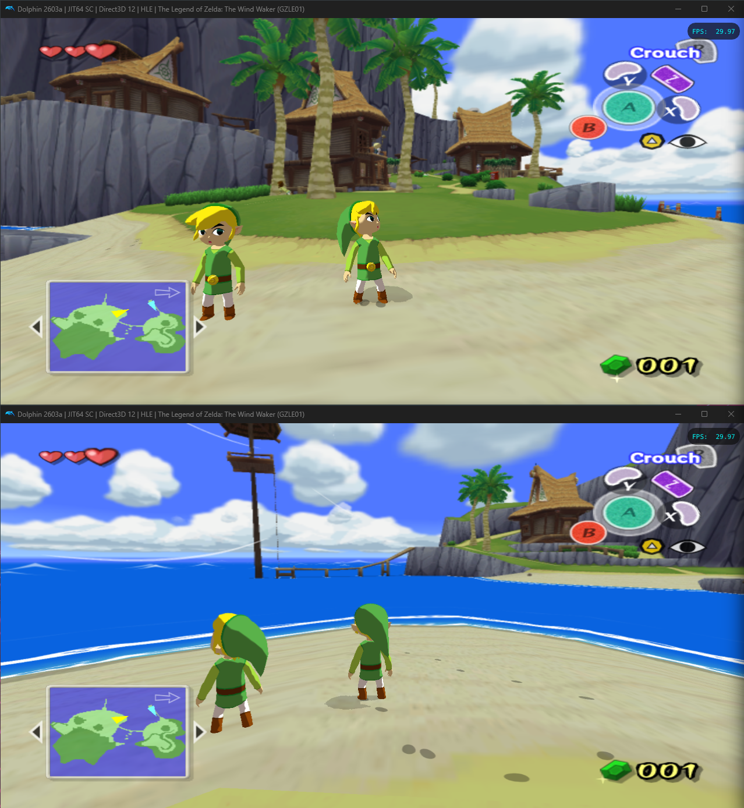
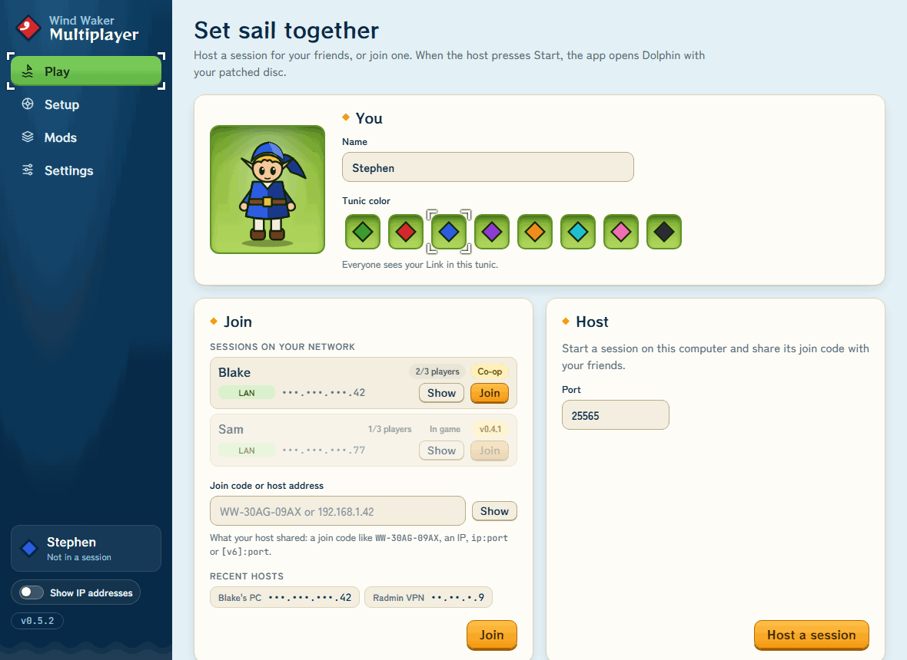
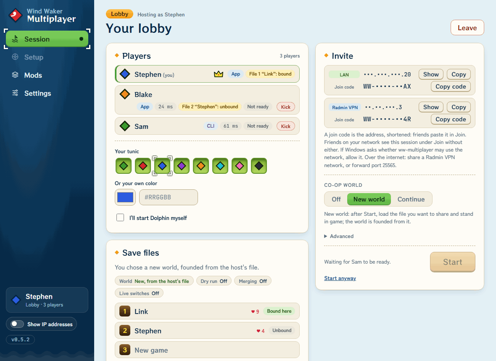
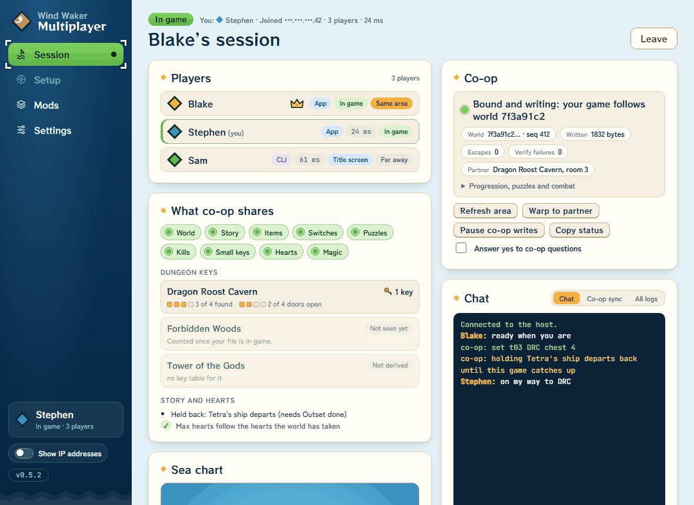

# Wind Waker Multiplayer

**See your friends' Link run around in your Wind Waker.** Everyone plays their own copy of
The Legend of Zelda: The Wind Waker on Dolphin, and each player's real Link, with real
animations and their own tunic color, shows up in everyone else's game. Shared enemies,
optional co-op worlds, and join codes instead of IP addresses. Windows and macOS (Apple
Silicon and Intel).

| Pick your name and color | Gather in the lobby | Play together |
|---|---|---|
|  |  |  |

## Get started in 3 steps

You need [Dolphin](https://dolphin-emu.org/) and your own copy of Wind Waker (NTSC-U,
`GZLE01`). Nothing of Nintendo's is shipped: the app patches your own disc, and your
original is never changed.

1. **Download** from the [latest release](../../releases): `ww-multiplayer.exe` for Windows,
   `ww-multiplayer-macos.zip` for macOS.
2. **Open it.** Windows: if SmartScreen warns, click **More info → Run anyway**. macOS:
   Control-click `WW Multiplayer.app` → **Open**, then press **Prepare Dolphin** once in Setup.
   (The downloads aren't code-signed yet, so each OS warns the first time.)
3. **Host or Join.** Setup finds Dolphin and patches your disc, then one player presses
   **Host** and the others **Join** (a session on your network shows up by itself, or paste
   the host's join code). When everyone is Ready the host presses **Start**.

Friends across the internet? A VPN is optional, but it's the easy way: put everyone on
[Tailscale](https://tailscale.com) or [Toru](https://stephenshorton.github.io/toru/) (Windows), both free with no router setup,
and join the host's address on it: see
[Playing over the internet](docs/online.md).

## Read more

All the docs are in the **[docs hub](docs/README.md)**, grouped as:

- **Play:** [install](docs/install.md), [playing](docs/playing.md), [updates](docs/updates.md), [what works](docs/status.md)
- **Host:** [over the internet](docs/online.md), [self-hosting a server](docs/11-self-hosting.md)
- **Build:** [building from source](docs/building.md), [releases](docs/releasing.md), [SETUP.md](SETUP.md)
- **Internals:** [architecture](docs/01-architecture.md), [the modding API](docs/api/00-design.md), [testing](docs/TESTING.md)

Work in progress is tracked in [GitHub issues](../../issues).

## License

[MIT](LICENSE) — do whatever you want with it, no warranty, not liable.

This project does not include or distribute any Nintendo IP. The patcher
splices our own injected code into your own legitimately-acquired Wind
Waker disc image. You are responsible for the legality of your own ISO
in your jurisdiction.
